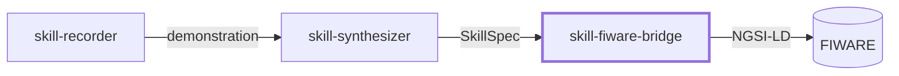
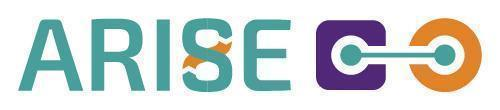

# Skill FIWARE Bridge

A Python module that publishes skill, task-step and component events from a ROS 2 robot cell to FIWARE Orion-LD as NGSI-LD entities.

> **Status:** this repository is being prepared. The first public release, with source code, installation guide and a runnable example, is planned for **June 2027**.

## Related modules

`skill-fiware-bridge` is designed to be used on its own or together with two companion modules:

*skill-fiware-bridge can also publish task-step and component events from your own robot application.*

- [skill-recorder](https://github.com/eurodao/skill-recorder)
- [skill-synthesizer](https://github.com/eurodao/skill-synthesizer)

## Features

- Publishes skill approvals, task steps and component events as NGSI-LD entities, live during a run.
- Resumes after a restart without losing or duplicating events.
- Open NGSI-LD data models for skills and execution traceability.

## Requirements

- **OS:** Ubuntu 24.04.
- **Python:** 3.12.
- **FIWARE:** Orion-LD context broker (NGSI-LD API).
- **ROS 2:** Jazzy on the robot-cell side; the bridge itself does not need ROS 2.

## Usage

The bridge reads the event records written by the robot cell and writes them to an Orion-LD broker. Configuration, installation and a runnable example will be documented with the first release.

## License

Copyright © 2026 euroDAO SAS.

Code: [GNU General Public License v3.0 only](LICENSE) (`SPDX-License-Identifier: GPL-3.0-only`).

Data models in `data-models/` are separate works under [Creative Commons Attribution 4.0 International](https://creativecommons.org/licenses/by/4.0/) (`SPDX-License-Identifier: CC-BY-4.0`).

## Maintainer

**euroDAO SAS**, Montpellier, France · [eurodao.com](https://eurodao.com) · info@eurodao.com

## Acknowledgements

Developed by euroDAO SAS within the MENTOR experiment of the ARISE project, for the ARISE Catalog.

&nbsp;&nbsp;

Funded by the European Union. Views and opinions expressed are however those of the author(s) only and do not necessarily reflect those of the European Union or European Commission. Neither the European Union nor the granting authority can be held responsible for them. Co-funded under Horizon Europe Programme of the European Union under Grant Agreement no. 101135784.
